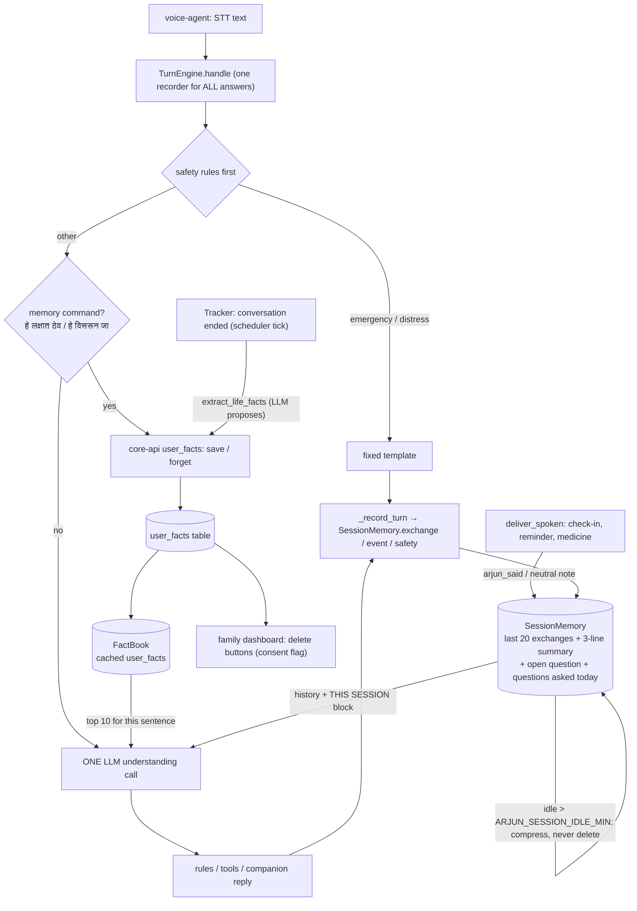

# Arjun: engineering notes (2026-10-31)

## Prisma integration audit (2026-11-07)

The voice-agent requirements pin `livekit-plugins-gnani==1.8.6`. Its installed `gnani.STT` constructor
accepts `language`, `sample_rate`, `base_url`, `preferred_language`, `format`, `itn_native_numerals`,
`use_streaming`, and `api_key`. It does not accept a model selector, Auto-LID, keyterms, named speakers,
previous-context state, or the product brief's `codemix` and `transliterate` modes. The package therefore
does not let this application explicitly select `prisma-v3.0`; its internal `/stt/v3` endpoint name alone
does not establish that model. The plugin's extra keyword handling also does not provide a documented way
to send the v3 product-page request fields.

The application uses `format=transcribe` by default, `itn_native_numerals=true`, `mr-IN`, 16 kHz, and
streaming enabled. Configuration validation now rejects unsupported format names and the `auto` language
placeholder instead of silently implying those features work. Only `verbatim` and `transcribe` are exposed.
No model upgrade or direct WebSocket implementation was made because the request/response event schema and
authentication details for the v3 product API were not supplied by the pinned package. A compatible adapter
needs official API wire documentation or an updated Gnani-supported SDK, then mocked protocol tests and live
account validation.

`scripts/check_gnani.py` reports whether `GNANI_API_KEY` is present/nonempty and whether it has surrounding
whitespace, along with configured model/mode labels. It performs no API call, so it does not verify
authentication. TTS remains configured as `timbre-v3.0` / `Avinash` with an existing probe and fallback to
`timbre-v2.5` / `Omkar`; v3.0 voice availability has not been verified live. The only historical live TTS
evidence is a v2.5 response on 2026-10-21. No live Prisma or full spoken-turn verification is recorded.

How the "learn important" topics from the brief show up in this codebase: where to look, why it was built that way,
and what is still missing. Every claim points at code or a test. Numbers are only the ones we measured.

## 1. Microservice architecture

```
 elder device (React, hands-free) ──LiveKit──▶ voice-agent ──HTTP──▶ reasoning ──HTTP──▶ core-api ──▶ SQL
 family dashboard (React) ──REST + WebSocket──▶ core-api                           ▲
 scheduler (poll loop, 30 s) ──HTTP──────────▶ core-api, reasoning ─────────────────┘
```

| Service | Owns | Never does |
|---|---|---|
| `core-api` | all state (SQL), validation, the family feed (WS), undo | talk to the LLM or Gnani |
| `reasoning` | one turn: safety rules → intent → action → reply; Sarvam calls; conversation summaries | store anything itself (state is in core-api; drafts/history are in memory only) |
| `voice-agent` | Prisma STT, Timbre TTS, the LiveKit room, screen attributes | business logic (it only calls reasoning) |
| `scheduler` | time: due reminders, medicine ticks, delivery sweep, summary flush | decide anything (it only triggers endpoints) |
| `web` | the two UIs | hold secrets (the dev proxy injects the key) |

Contracts are HTTP + JSON (`shared/schemas/*.json` for LLM output). Services share contracts, not code: the token
bucket exists twice on purpose (`core_api/ratelimit.py`, `reasoning_svc/ratelimit.py`).

## 2. Latency (the "app is lagging" problem)

Measured before (STATUS.md, 2026-10-24/26): end of speech → Arjun speaking, median **4174 ms** (5 turns); one
`/turn` round trip median **351 ms** after the `localhost` → `127.0.0.1` fix (was 2334 ms).
Where the rest went: endpointing wait (1.0 s minimum), Prisma final transcript, a NEW Timbre WebSocket per reply
(~0.9–1.2 s connect, measured), then first audio.

Changes on 2026-10-31 (each is a lever, none re-measured live yet):
- **Timbre over SSE** (`agent.py: SseTimbre`): one pooled HTTP session, no WebSocket handshake per reply, and LiveKit
  sends each *sentence* as soon as it exists (the TTS is marked non-streaming so the StreamAdapter chunks it).
- **Endpointing 1.0/3.0 s → 0.7/2.5 s**, then (night of 2026-10-31) **mode-aware**: care 0.8/2.5 s, chat 1.6/4.0 s, plus a hold
  for sentences ending in a conjunction and VAD turn detection (`voice-agent/endpointing.py`). Chat answers ~0.9 s later by design; unmeasured live.
- **No question round-trip**: a reminder is one turn instead of two (no "हो" turn).
- **Sarvam thinking off** (`reasoning_effort: null`): no hidden reasoning tokens before the answer.
- **Work after the reply**: activity time and the conversation buffer are FastAPI background tasks.
- **Thinking marker** ("विचार करतोय…") so the wait is visible, not silent.
- Smoke run on the cloud box (rules only, no LLM): `/turn` 31–125 ms per turn.

To measure next: `logs/turns.jsonl` already splits endpointing / reasoning / TTS per turn (`turnlog.py`).

## 3. Concurrency

- Delivery claim is atomic in SQL (`deliveries.claim_delivery`, a conditional UPDATE): two sessions never speak the
  same reminder (`test_deliveries.py` runs it from threads).
- One speech lock in the agent: a reply, a reminder and a closing line never overlap (`agent.py: speech_lock`).
- LLM: at most `LLM_MAX_CONCURRENT` calls in flight (`evon.Limiter`, a non-blocking semaphore). A voice turn never
  waits in a queue: over the limit, the rules answer at once.
- Feed WebSocket: sync endpoints run in worker threads, sockets on the event loop; `feed.Broker.notify` crosses with
  `loop.call_soon_threadsafe`. A socket also re-checks SQL every 5 s, so a missed wake-up only delays.
- Known limit: drafts, chat history, undo memory and the conversation buffer are per process (one reasoning
  replica). Two replicas would need them in core-api or Redis.

## 4. Rate limiting

| Where | Key | Limit | Over it |
|---|---|---|---|
| core-api HTTP (`ratelimit.RateLimitMiddleware`) | client address | 30/s, burst 60 | 429 + `Retry-After` |
| reasoning `/turn` | user id | 2/s, burst 6 | 429 → the voice agent speaks its fallback line |
| Sarvam calls (`evon.Limiter`) | process | 60/min | rules answer |
| Sarvam 429 | process | cool-down for its `Retry-After` (1–300 s) | rules answer, no retry storm |

Token bucket: `burst` tokens, refilled at `rate`/s, one per request (`test_token_bucket_allows_a_burst_then_refills`).
`/health` and WebSockets are exempt.

## 5. Polling vs WebSocket (family dashboard)

- **Push**: `WS /ws/users/{id}/feed?after=N` sends `{"type":"event",...}` the moment a row is committed, `ping` when
  idle. Every Notification and Wellbeing row becomes a FeedEvent in a SQLAlchemy `before_flush` hook, so no endpoint
  can forget to publish.
- **Fallback**: `GET /users/{id}/feed?after=N` returns the same rows with the same ids. `web/src/family/feed.ts`
  loads over REST first, opens the socket, polls every 5 s while the socket is down, and retries the socket at
  1/2/5/10/30 s. `mergeFeed` de-duplicates by id, so overlap is harmless.
- Still polling on purpose: the emergency alarm (15 s, also in a background tab), the dashboard refresh (10 s while
  visible), the elder screen's cards (5 s). Polling is simple and survives proxies; push is used where seconds matter.

## 6. Error handling

- **Never silence**: a reasoning failure becomes a fixed spoken line (`bridge.reply_or_fallback`); a TTS failure
  speaks the fallback; core-api down → fixed error template; safety replies work with core-api AND the LLM down.
- **Fail closed**: core-api refuses to start without `CORE_API_KEY`; a bad WS key closes with 4401.
- **No half states**: if an auto-confirm fails, the proposal is withdrawn (`TurnEngine._act`), and a failed turn
  drops any half-built reminder draft (both found in the 2026-10-31 smoke run; regression tests in
  `test_no_questions.py`).
- **Graceful degradation**: Timbre v3.0 is probed once per worker; on failure the verified v2.5 + Omkar is used
  and tags are stripped. No Sarvam key → rules-only mode.
- **Bug found by running it**: row timestamps used the machine clock while `get_now` used the household clock.
  On a UTC machine (Docker) every action expired the instant it was proposed. Fixed in `models.utcnow`.

## 7. Boundary analysis (edge cases the tests pin)

Time: "१०:३०" (native numerals), "दहा वाजता" without सकाळी/संध्याकाळी → asks, a time already past → asks again, midnight
day boundaries, undo at 150 s vs 180 s windows. Language: Devanagari + roman, chandrabindu/nukta spelling folds,
"मला एकटं नाही वाटत" (negated) is not lonely, "लहानपणी मी एकटी होते" (past) is not lonely. Recognizer junk
("हो हो हो कर कर कर…") collapsed. Feed: `after=0` first load, unknown severity ignored, cap 200. Rate limits:
exactly `burst` then 429. Voice tags: unknown tags removed, max 2, case normalised.

## 8. Identity management and encryption (honest status)

Today: one shared service key (`X-API-Key`, constant-time compare), injected by the Vite dev proxy so it never
reaches the browser bundle; LiveKit tokens are short-lived, minted server-side, one fresh room per session; secrets
live only in `.env` and are never logged (`test_repo_hygiene.py`). Transport encryption: LiveKit Cloud is
TLS/DTLS-SRTP; Gnani and Sarvam are HTTPS. **Not built** (frozen in CLAUDE.md until after Nov 10): per-person
login, elder vs family roles, encryption at rest for the SQL file, HTTPS for the local web server.

## 9. Frontend API calls

All calls go through `/core/*` on the same origin (`web/src/api.ts`, one `call()` helper that throws on non-2xx).
The dashboard never blanks on a failed refresh (keeps the last data and says so). The elder screen never calls
reasoning: it talks only through LiveKit; the screen mirrors agent attributes (`voice/state.ts: shownFor`).

## 10. Visualization / problem solving

The family sees one headline (seriousness chip + mood + last summary), then the live feed, then the day. Colour is
never the only signal: every level has words ("All well", "Keep an eye", "Call her soon", "Emergency").

## 11. Business and technical impact

- Elder: zero buttons, no yes/no interrogation; reminders in one sentence; a reply to loneliness that points to a
  real person by name. Family: knows within seconds when it matters (push + alarm), sees a calm day as a calm day.
- Technical: the LLM is optional and boxed in (validated JSON, limits, rules floor), so a provider outage or bill
  limit degrades conversation quality, never safety or reminders.
- Costs not yet measured: Prisma credits for an always-open session (hands-free keeps the mic streaming), Sarvam
  tokens per day, LiveKit minutes.

## 12. Software engineering fundamentals

Tests first for every decision that must not be wrong (pure functions: `shownFor`, `restingScreen`, `mergeFeed`,
`split_voice_tags`, `Tracker.entry`, token buckets), one commit per task, lint (ruff) + strict TypeScript, and
"verified" only for what was actually run (STATUS.md keeps the line between tested and hand-tested).

## 13. Apps by voice (2026-11-02)

**Who decides what.** The family owns `app_links` (core-api: kind, label, value, spoken names; https only; a host off the allowlist needs an explicit
approval and is flagged; WhatsApp rows point at a contact, numbers stay in `contacts`). Reasoning only CHOOSES among those rows (`turn.py: _app_command`);
the LLM may suggest an intent and a label (`shared/schemas/intent.json`: `media_query`, `link_label`, `media_control`) and can never produce a URL.
Every spoken line is a fixed template (`app_replies.py`); headlines are copied verbatim by core-api (HTML stripped, whole word at 120 characters).

**Action contract.** `TurnResult.action = {type: open|control|none, kind, value, title}` -> `/turn` JSON -> `BridgeReply.action` -> participant attribute
`arjun.action` = JSON `{type, kind, value, title, turn}` (`screenstate.py`; "" clears it; never set on a safety reply). The page (`voice/action.ts`)
re-validates (YouTube id shapes, `wa.me`, https) and performs each action ONCE (`turn` newer than the last performed). Kinds: `youtube_video |
youtube_playlist | youtube_channel_live | whatsapp | link`; controls: `stop | pause | resume | next | volume_up | volume_down`.
The page reports its player as attribute `arjun.media` = `playing | stopped`.

**Media-mode filter** (`voice-agent/mediamode.py`). While `playing` (page report, or the agent's guess after publishing a video action; reset when the page
leaves): a transcript passes if it starts with the wake word, or reasoning's `POST /media/gate` says `control` (bare stop / next / volume) or `safety`
(emergency / distress lexicons). Otherwise it is dropped, logged as `ignored_media` WITHOUT its words. If the gate cannot answer, the transcript passes:
safety is never ignored. The lexicons stay in reasoning (services share contracts, not code).

**Quota and caching.** YouTube `search.list` = 100 units of 10,000/day. Cache 24 h per normalised query (SQLite `youtube_search_cache`); uncached calls
capped per day (`YOUTUBE_MAX_SEARCHES_PER_DAY`, default 80); a Google quota error blocks further calls until the next day; 503 `youtube_not_configured` /
429 `youtube_quota` make reasoning open the YouTube results page. News: feeds fetched in parallel (5 s timeout), top 5 interleaved, cached 15 min in
memory, a total failure is not cached. Not measured: real latency of search or feed fetch from the voice path.

## 14. LLM-first turn understanding (2026-11-04)

**Why the rules moved.** The rule parser was the first reader of every sentence. It could only see keywords, so it
hijacked ordinary talk (a story containing "औषध" became a medicine question), it could not answer a question about her
own day, and its miss path was a dead end ("मला समजलं नाही"). Marathi word order and STT noise make keyword reading
worse than useless for conversation; the LLM needed the whole sentence, not a pre-digested intent.

**One call, one contract.** `TurnEngine.handle` runs the safety floor first, then makes exactly one
`EvonClient.understand_turn()` call for the turn (no second classification call). The model gets the full transcript,
the last turns and a USER CONTEXT block; it must return strict JSON
`{intent, slots, reply, confidence}` with intent in
`chat | reminder_add | reminder_done | medicine_taken | medicine_query | media | news | call_family |
message_family | today_query | undo | stop | health_complaint | unclear`. Legacy names (`OPEN_LINK`,
`OPEN_WHATSAPP`, `MEDIA_CONTROL`, `MED_SNOOZE`, `TIME_QUERY`, `NEXT_UP`) are still accepted and marked `legacy`, and
plain prose is used as the chat reply, so a provider that ignores the JSON contract costs no extra call.

**Where the decision actually sits.** The LLM decides *what she means*; the existing deterministic code decides *what
happens*. Action intents execute the same SQL-backed paths and fixed read-backs as before, so a hallucinated `reply`
can never invent a reminder time or a medicine record. Deterministic state answers (pending yes/no, stop, medicine
taken, time/next-up, greeting, hearing check) are still rule-decided after the call: state machines are cheaper and
safer in code than in a prompt.

**Fallback and logging.** Rules run only when the LLM times out, errors, returns invalid JSON, returns an unknown
intent, or reports confidence below 0.4 for an action intent. Each such turn is logged with `source=rule` and a
`route_reason`, so a regression is visible as a change in the LLM/rule ratio rather than as a vague "it feels dumber".
The safety floor is never gated on the LLM: emergency/distress rules and the fail-safe second look work with the LLM
and core-api down.

**An answer must look like an answer.** Marathi puts "नाही" inside ordinary sentences, so the rule layer used to read
"माझी तब्येत बरी नाही" and "माझा चस्मा सापडत नाही" as "no" to whatever question was open: the first cancelled the
pending reminder and said the family was told help is not needed, the second undid the previous action. Now a yes/no
is rule-decided only when it opens with a yes/no word or is at most two words ("हो", "नको", "नाही, नको"); a longer
sentence goes to the LLM, and the pending question is repeated rather than cancelled. A correction of a pending
reminder is still rule-decided, but only when the sentence restates a clock time ("सकाळी दहा वाजता … नाही जायचं"),
which is what separates a correction from a fact about her day.

**Context instead of memory in the prompt.** `_user_context` asks core-api for the facts the companion is allowed to
know, caches them for 5 minutes and caps the block at 700 characters: name and address form, family names/relations
(never phone numbers), date/day/festival, today's medicines taken/missed, appointments and reminders, recent check-in
answers, interests, and only the last conversation summary. Nothing is stored by reasoning itself, and the block is
built from SQL through `GET /users/{id}/checkins/card` and `GET /users/{id}/wellbeing/today`.

**Output discipline.** `max_tokens` defaults to 250 (`LLM_MAX_TOKENS`), temperature 0.5, reasoning off.
`finish_reason=length` trims the text back to the last complete sentence instead of speaking a cut line. The
sanitizer rejects only what must not ship: medical advice/diagnosis, claims of being human or having a body/family,
Latin script, more than 4 sentences or 300 characters. One retry with a corrective note, then a fixed fallback line.
Rules the prompt owns (no guilt, no recipes, no invented facts, always offer a solution) are deliberately NOT
duplicated in the sanitizer: a hard filter cannot tell a good recipe answer from a bad one, and would only mangle it.

**How it is measured.** `scripts/eval_companion.py` runs 50 realistic utterances through the real `/turn` endpoint in a
temporary stack (throwaway SQLite, Sarvam for the turn and for a strict-JSON judge on
`relevant/understood/about_her/solution/natural_marathi/safe`), plus a replay of the last N real turnlog transcripts.
Each utterance gets its own throwaway user: the rows are independent sentences, and a shared user leaked a pending
reminder, an undo window and one conversation's history into the next item. `--legacy` sets the old 80-token budget;
run the previous commit from a worktree to get the real "before". Treat the averages as a regression signal, not a
benchmark: the judge is an LLM, the set is synthetic, and no native speaker has reviewed it. The averages are also
noisy at temperature 0.5 - the stable signals are turns that complete, action-intent accuracy, the LLM/rule route
count and banned-line count, so report those.

## 15. Memory: session + long-term (2026-11-04)

Two layers, both private, both small. The LLM never writes either: reasoning records what was really said, core-api
validates and stores facts (boundary 1).



**Session memory** (`reasoning_svc/memory.py`, in process memory only). Every spoken line goes through ONE recorder
(`TurnEngine.handle` wraps `_handle`; nested calls record once): rule replies, tool/action replies (plus a note
such as `opened for her: <title>`), safety replies, memory commands, companion replies. Lines Arjun says first
(check-ins, reminders) are recorded when they are really SPOKEN (`deliver_spoken`); a released delivery is not.
Medicine and reading turns leave only a neutral note (boundary 6). The last `ARJUN_SESSION_EXCHANGES` (20) exchanges
are kept word for word; older turns, and a whole conversation after `ARJUN_SESSION_IDLE_MIN` (30) minutes of silence,
are compressed (rules, no LLM) into at most three summary lines. After 24 h only the long-term facts remain. A safety
event keeps the history and adds a note ("be gentle, no small talk"). The question Arjun is waiting for (10 min) and
the questions already asked today go into the system prompt, so "वरण भात" is read as the answer to the lunch check-in.
A history that would start with an Arjun line moves that line into the prompt (providers need the chat to start with
her).

**Long-term memory** (`core_api/facts.py`, table `user_facts`: fact, kind, source_date, last_used, confidence,
source). After a conversation ends, `Tracker.remember_life` asks the LLM for durable facts as strict JSON and PROPOSES
them; core-api refuses numbers, money, addresses, medicines and diagnoses, accepts a `concern` only with the consent
flag, and dedupes (people are `नाव — नातं`, so the same person is one row). Each LLM call gets up to 10 facts ranked by
shared words with the sentence, people, and recency (an event told yesterday is flagged so Arjun can follow up).
"हे लक्षात ठेव" saves one fact on her word with a one-line read-back; "हे विसरून जा" deletes the best match and scrubs
the same words from the session. The family list ("अर्जुनला माहीत असलेल्या गोष्टी") shows facts only, behind the same
consent flag as the conversation summaries; deleting needs none.

**Companion behaviour.** The prompt asks Arjun to use names and earlier talk, answer real questions in 1-3 sentences
(a recipe and anything about health or medicines are still never answered from memory: boundaries 5, 6, 10), never
guess a memory, and write at most one question per reply. In code: only the first question survives, a question is
dropped when the last reply was one or it repeats a question asked today, and a reply with one blocked sentence
("... आराम करा") is salvaged instead of replaced by a fixed line.
