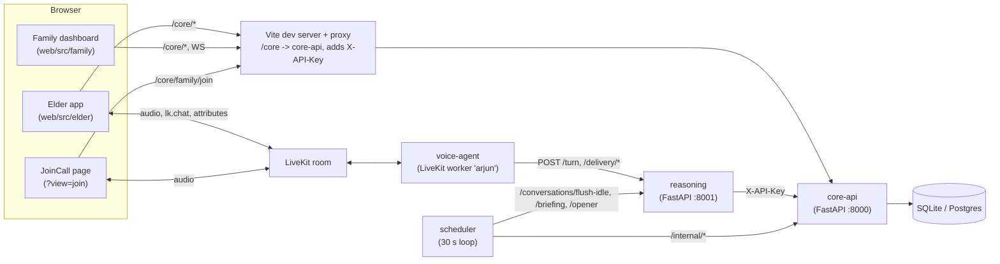
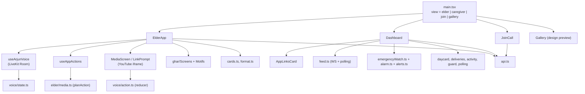
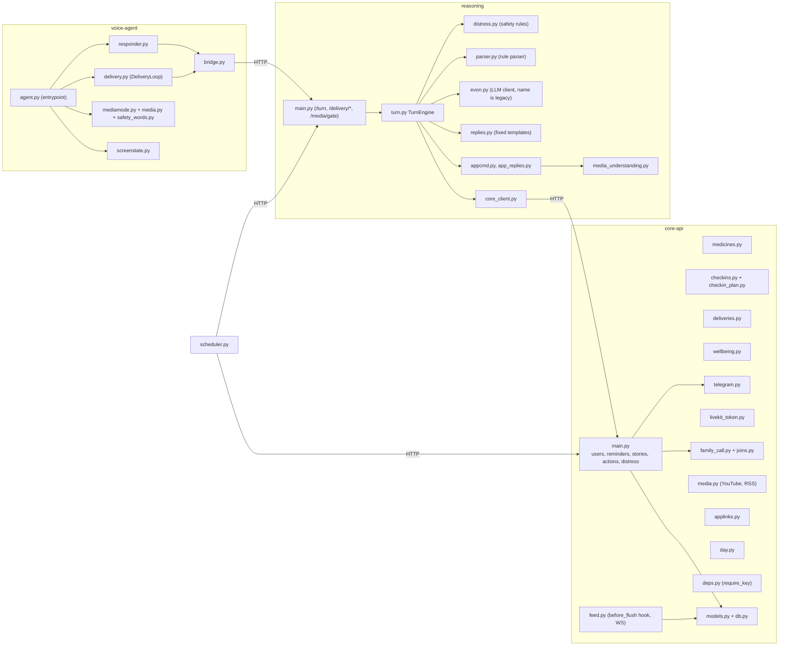
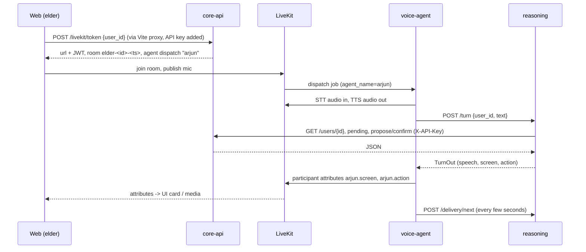
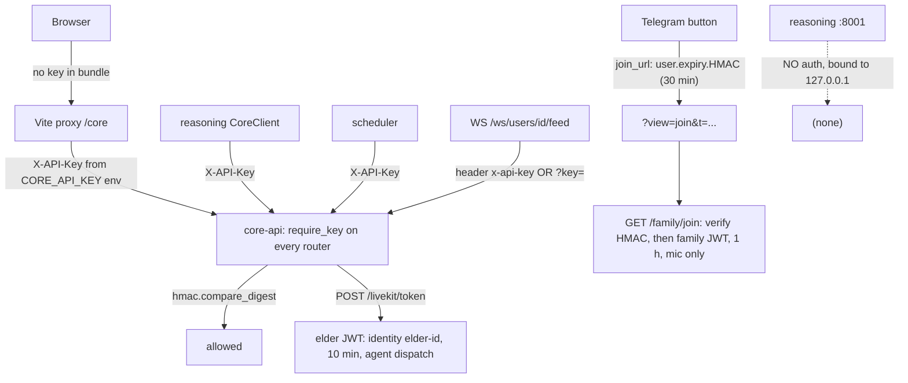
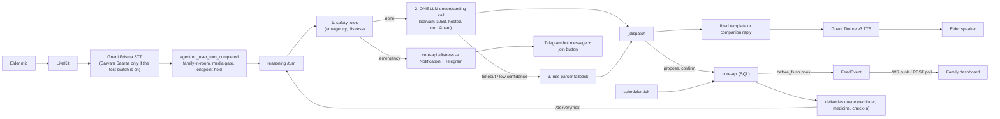
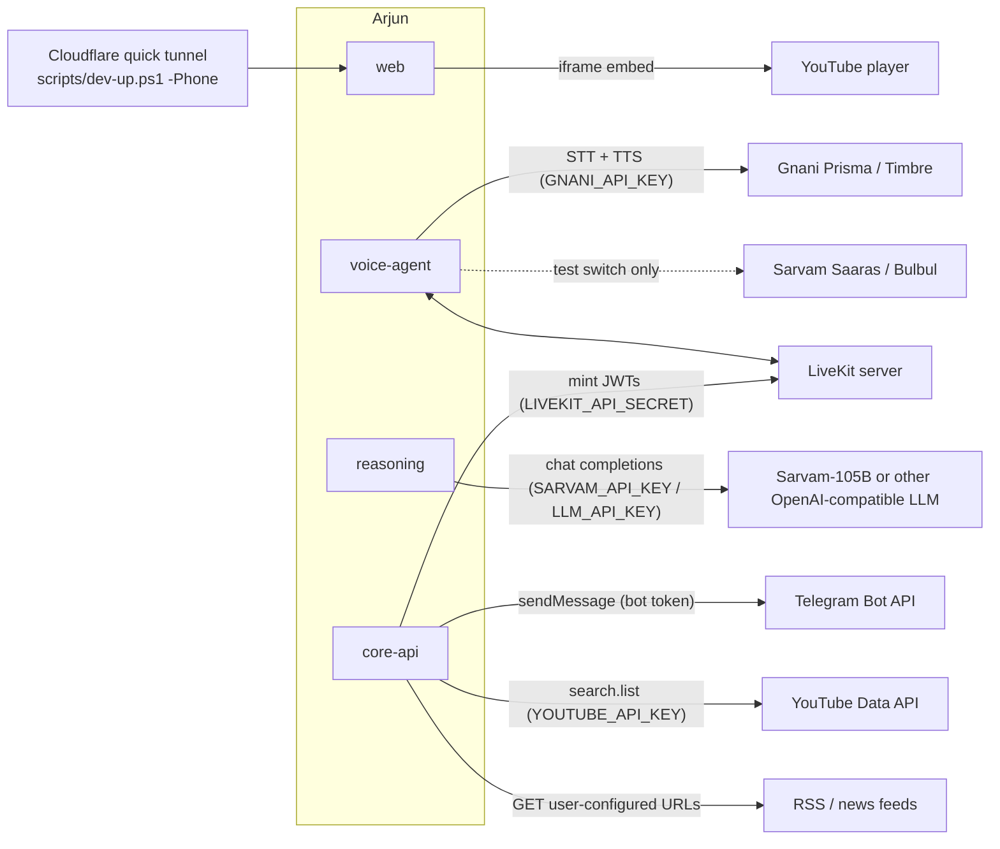

# Arjun architecture

Source: Graphify graph of 201 code files (3,342 nodes, 8,592 edges), confirmed by reading the code.
The graph was built with `graphify extract . --code-only` (AST only), so docs (`*.md`) are not in the graph.
Mermaid diagrams were **not rendered to SVG** because `mmdc` is not installed (see the end of this file).

## 1. Overall system

## 2. Web (React) component hierarchy

## 3. Backend services

## 4. API flow across services

## 5. Database tables and relationships (core-api/models.py)

Every table except `youtube_search_cache` points at `users.id`. `medicine_doses` also points at `medicines.id`.
`deliveries.ref_id` is **polymorphic with no foreign key** (reminder, medicine dose or check-in, chosen by `kind`).

```mermaid
erDiagram
  USERS ||--o{ CONTACTS : has
  USERS ||--o{ REMINDERS : has
  USERS ||--o{ APPOINTMENTS : has
  USERS ||--o{ STORY_MEMORIES : has
  USERS ||--o{ PENDING_ACTIONS : has
  USERS ||--o{ CAREGIVER_REQUESTS : has
  USERS ||--o{ NOTIFICATIONS : has
  USERS ||--o{ DISTRESS_EVENTS : has
  USERS ||--|| ACTIVITY : has
  USERS ||--o{ WELLBEING : has
  USERS ||--o{ FEED_EVENTS : has
  USERS ||--o{ TOPIC_DECLINES : has
  USERS ||--o{ CHECKINS : has
  USERS ||--o{ BP_READINGS : has
  USERS ||--o{ WATCH_SAMPLES : has
  USERS ||--o{ MEDICINES : has
  USERS ||--o{ DELIVERIES : has
  USERS ||--o{ MEDICINE_DOSES : has
  USERS ||--o{ APP_LINKS : has
  MEDICINES ||--o{ MEDICINE_DOSES : schedules
  NOTIFICATIONS ||..o{ FEED_EVENTS : "mirrored by flush hook"
  WELLBEING ||..o{ FEED_EVENTS : "mirrored by flush hook"
  DELIVERIES }o..o{ MEDICINE_DOSES : "ref_id when kind=medicine (no FK)"
  DELIVERIES }o..o{ REMINDERS : "ref_id when kind=reminder (no FK)"
  DELIVERIES }o..o{ CHECKINS : "ref_id when kind=checkin (no FK)"
```

## 6. Auth

Notes: there is one shared API key and no per-user authorization. Any caller with the key can read or write any `user_id`. `reasoning` has no authentication at all and relies on the loopback bind.

## 7. Data pipeline

## 8. External integrations

